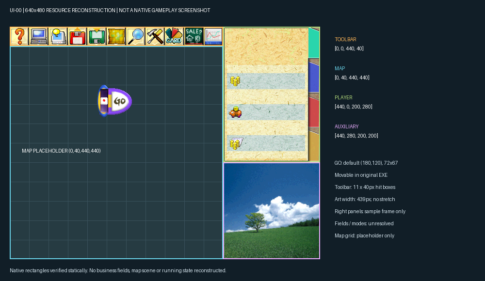

# UI-00：原版 UI 资源与坐标审计

日期：2026-10-18。状态：**UI-00 完成**。代码基线 `817abba`。下文记录 UI-00 审计时的状态；后续 UI-01 已完成，见 [主界面骨架记录](ui01-main-shell.md)。

本轮交付可复跑导出、机器清单、26 张分页联系表、主界面标注图和未知项表。没有修改游戏界面、规则、发布白名单或生产环境。完成的是审计，不代表这些素材已接入 Web。

后续执行优先级（2026-10-18 用户确认）：以复原 UI 为核心。尚未实现的业务保留原版入口、图标和位置，点击明确提示未接入，实际业务挂起；不阻塞已核实 UI 的还原与验收。UI 和业务接入状态分别记录，具体要求见 [实施计划](original-ui-restoration-plan.md)。

## 交付物与复跑

- [机器清单及原生字节证据](original-ui-resource-audit.json)：源文件 SHA-256、归档目录、15 组图像资源共 450 帧、每帧尺寸/锚点/像素与 PNG 哈希、工具栏热区、原生地址与证据字节。
- [联系表索引](ui00/README.md)、[主界面标注图](ui00/main-layout-annotated.png)、[四名现用角色对照](ui00/current-characters.png)。
- [导出脚本](../../scripts/richman/export_ui.py)、[映射与证据目录](../../scripts/richman/ui_catalog.py)、[测试](../../scripts/richman/test_ui_export.py)。
- 独立图片包生成到 `frontend/public/richman/generated/ui/`，包含 `manifest.json`、450 张 PNG 和 `go-hit-mask.bin`。该目录沿用已有 ignored 规则；UI-01 后按实际使用范围登记发布资产，不能直接把候选窗口全量接入。

在仓库根目录运行（Python 环境需要 Pillow、NumPy；需 C 编译器，与已有美术导出器一致）：

```bash
python3 scripts/richman/export_ui.py --game /Users/zsr/Documents/rich4/Game
python3 -m unittest discover -s scripts/richman -p 'test_ui_export.py'
```

当前机器可使用 `/Users/zsr/.cache/codex-runtimes/codex-primary-runtime/dependencies/python/bin/python3`。脚本支持 `--output`、`--evidence`、`--audit` 指定其他输出位置，以便干净目录重复导出和比较。禁止输出到原游戏目录内。

脚本先核对四个输入文件的固定哈希，再编译仓库已有 MKF 解压器；不执行 EXE，不联网，不运行外部参考项目。完成时再次核对源文件。不同版本资源必须重新审计，不能关闭哈希检查继续套用索引。PNG 使用当前 Pillow 编码器；跨编码器版本优先比较 `rgbaSha256`，同环境重复导出应逐字节相同。

## 依据与可信边界

| 等级 | 本轮用途 | 边界 |
| --- | --- | --- |
| `local-art` | 本地图像的帧数、尺寸、锚点、图案与像素 | 不能仅凭图案断言点击行为 |
| `native-static` | 本地 `rich4.exe` 的绘制矩形、工具栏热区、帧选择、GO 初值/拖动、Panel 装载索引 | 静态分析，没有运行原版做操作回归 |
| `native-static+reference` | 本地跳转表/call 结构与公开项目的具名函数对应 | 函数名称采用跨版本参考；不是从本地 EXE 符号表直接读出 |
| `unresolved` | 全屏业务素材和未确认的状态帧 | 只导出供后续核实，不能标成已接入 |

公开参考固定为 [mytbk/rich4 的 ec7d70e](https://github.com/mytbk/rich4/tree/ec7d70e693059d1e781d9d1cc2ad7f36d360d39e)，重点核对 [工具栏分发](https://github.com/mytbk/rich4/blob/ec7d70e693059d1e781d9d1cc2ad7f36d360d39e/asm/rich4_ui_clicking_top_panel.asm)、[绘制/交互汇编](https://github.com/mytbk/rich4/blob/ec7d70e693059d1e781d9d1cc2ad7f36d360d39e/asm/rich4.asm) 和 [锚点及 GO 绘制](https://github.com/mytbk/rich4/blob/ec7d70e693059d1e781d9d1cc2ad7f36d360d39e/csrc/drawing.c)。该参考与本地原版有版本差异：本地标题资源只有 9 帧、4 个菜单项；参考开始菜单包含额外项目。不得照搬参考的 EXE 地址或角色资源编号。

审计 JSON 记录本地虚拟地址、PE 文件偏移和完整证据字节；复跑会验证 11 项跳转表、各分支调用目标和 GO 初始坐标。截图仅作为风格参考；本轮没有把官方说明书标为已完整读取。

## 主界面坐标：可以交给 UI-01

统一逻辑画布 **640×480**。矩形均为 `(x,y,w,h)`，Web 热区采用左上包含、右下不包含的边界。

| 区域 | 矩形 | 本地证据 |
| --- | --- | --- |
| 顶部工具栏 | `(0,0,440,40)` | `0x4156ff` 设置绘制 RECT |
| 地图 | `(0,40,440,440)` | `0x4157e3` 设置绘制 RECT |
| 人物资料区 | `(440,0,200,280)` | `0x415976` 设置绘制 RECT |
| 辅助区 | `(440,280,200,200)` | `0x41665d` 设置绘制 RECT |
| GO 初始位置 | `(180,120,72,67)` | `0x47310c/0x473110` 初值；Panel[7] 首帧尺寸 |



上图是**资源组合示意，不是原版运行截图**。地图网格为占位；右侧使用资料首帧与春季图示范区域关系，没有虚构人物、金额、日期或运行状态。GO 中的单骰标记是骰数选择示意，不是一次掷骰结果。

工具栏底图实际宽 **439**，逻辑区域宽 **440**。保持素材原尺寸，最后一列作为边界单独处理；精确边界像素需 UI-01 对比确认，不能把底图拉伸 1 像素。所有资源锚点遵循 `绘制左上角 = 参考点 − 锚点`，包括负值；不是把锚点直接当成 CSS left/top。

GO 是浮动控件：本地 `0x41826f` 开始的分支处理拖动并限制在画布内。`(180,120)` 是静态初值，不代表恢复存档或拖动之后的位置。Web 是否保留拖动由 UI-02 明确决定，并处理与地图选点的冲突。

## 工具栏：顺序、图片状态与热区

第 `i` 项（从 0 起）热区为 `(40*i,0,40,40)`，图像参考点 `(40*i+20,20)`。本地 `0x417e6c` 的点击分支按 `x/40` 编号，`0x417536` 是 11 项跳转表。

| i | 入口 | Panel[1] 正常/悬停帧 | 本地调用目标 | Web 接入约束 |
| --- | --- | --- | --- | --- |
| 0 | 帮助 | 1 / 12 | `0x44d468` | 游戏帮助入口 |
| 1 | 设置 | 2 / 13 | `0x4114a7` | 声音、显示及现有设置 |
| 2 | 托管设置 | 3 / 14 | `0x41dae8` | 对应现有电脑配置，不能误接为设置 |
| 3 | 读档 | 4 / 15 | `0x403ca6` | 保留入口，点击提示未接入；恢复业务挂起 |
| 4 | 存档 | 5 / 16 | `0x40407a` | 保留入口，点击提示未接入；存档业务挂起，回放下载另命名 |
| 5 | 小地图 | 6 / 17 | `0x40a5c8` | 浏览地图，不修改玩家位置 |
| 6 | 人物资料 | 7 / 18 | `0x423b4c` | 与地产资料/调试入口区别命名 |
| 7 | 道具 | 8 / 19 | `0x446948` | 对接已有库存与合法目标 |
| 8 | 卡片 | 9 / 20 | `0x4407f7` | 对接已有卡片决策 |
| 9 | 地产出售 | 10 / 21 | `0x427a79` | 保留挂牌与交易限制 |
| 10 | 股票 | 11 / 22 | `0x42aafd` | 对接股票窗口 |

第二组是**悬停帧**：本地鼠标移动分支 `0x418306` 更新当前图标索引，离开后设为 -1；绘制分支 `0x41567e` 使用 `i+12`。不能把这组图标同时标作“按下/选中/禁用原版帧”。这三类状态在 manifest 中为 `null`，后续如以 CSS 表现，须标为 Web 增补。触屏入口名称和键盘焦点也是 Web 适配。

## 资源范围与尚未接入项

| 归档 / 记录 | 已确认事实 | 后续阶段 |
| --- | --- | --- |
| Data[1] | 9 帧；640×480 标题，START/LOAD/OPTION/EXIT 各两张图 | UI-07 核对热区与状态 |
| Data[2] | 12 张 72×72 头像，现用四人可对照 | UI-02 / UI-07 |
| Data[3] | 16 帧；设置/表格/日历等窗口零件 | UI-07 逐项绑定 |
| Panel[0] | 6 帧，资料图常见 200×280，另有 400×80 帧 | UI-02 字段/配置核对 |
| Panel[1] | 23 帧；底图及 11 项正常/悬停图标 | UI-01 / UI-03 |
| Panel[2] | 12 帧；四季图、日历和日月零件 | UI-02 辅助区模式 |
| Panel[3] | 18 帧骰子，原始负锚点保留 | UI-02 复用当前骰子能力 |
| Panel[7] | 12 帧；GO/停止/慢行成对图与 1–3 骰数选择图 | UI-02 状态与动画绑定 |
| Panel[8] | **4824 字节原始掩码**，等于 72×67；值只有 1/2/3/4 | UI-02 点选语义，不能作为普通 SPR 解码 |
| Panel[4/5/6] | 非 SPR/SMP 数据，保留字节数与哈希 | 原版特殊演出，格式/触发未核实时暂缓 |
| Panel[9/10] | 25 / 38 帧，含全屏场景与控件 | UI-05/06 先核实业务身份 |
| Panel[21] | 26 帧，含数字键盘 | UI-04/05 数字输入 |
| Panel[23/24] | 24 / 30 帧，银行/ATM 外观 | UI-04 先核实控件与触发 |
| Panel[25/26] | 83 / 116 帧，含全屏图和大量零件 | UI-05/06 逐项识别，不能整组视为已完成 |

归档目录清点覆盖 Data 的 561 条记录、Panel 的 113 条记录；**只有上述 15 组图像和 4 组非图像数据进入本轮审计**。其余目录项只有偏移和压缩/解压长度，不代表没有素材、缺图、已识别或已覆盖全部原版 UI。业务窗口的完整覆盖仍由 UI-05/06 负责。

现有四人对照：孙小美 `Data[276]/map[24]/Data[2]帧9`；阿土伯 `171/19/4`；钱夫人 `150/18/3`；沙隆巴斯 `108/16/1`。本轮对照身体、地图头像与选人头像，未发现视觉错配。钱夫人是紫红发女性头像；金贝贝是 Data[2]帧11 的婴儿头像。未完整追踪本地姓名表到全部角色资源的调用链，不能据此直接扩展成 12 人全接入。

## 未知项与恢复条件

| ID | 未解决内容 / 证据边界 | 保留方案和恢复条件 | 影响阶段 |
| --- | --- | --- | --- |
| U01 | 工具栏第 440 列像素、遮挡时边缘绘制 | 不拉伸底图；同状态截图比对后冻结 | UI-01 |
| U02 | 资料字段坐标、字体、各资产的原版计算口径 | 当前引擎字段与计算继续使用；绘制分支/原版同状态画面核实后定位 | UI-02 |
| U03 | 辅助区配置、季节/日期/小地图切换顺序与热区 | 先提供明确的 Web 切换入口；追踪配置读取和点击分支再还原 | UI-02 |
| U04 | GO 掩码全部值的动作、禁用条件、闪烁/慢行优先级 | 已有初值、拖动与字节读取证据；逐个追踪分支并做运行验证后接入，不能直接把矩形全域设为掷骰 | UI-02 |
| U05 | 工具栏按下/选中/禁用图和键盘行为 | 使用明确标记的 Web 状态；不得把悬停帧重复冒充 | UI-03 |
| U06 | 标题四项精确热区、两组帧的触发状态及设置内部控件 | 以本地 9 帧为准；核对本地菜单调用/原版操作，不能复制扩展版第五项 | UI-07 |
| U07 | 候选业务场景身份、控件及剩余窗口资源 | 每窗登记旧入口→新入口→状态→验收场景；身份与业务确认后才进入发布白名单 | UI-04/05/06 |
| U08 | Panel[4/5/6] 非图像格式及特殊演出 | 暂缓原演出，保留当前骰子/文字反馈；格式和时序确认且 Web 可行时恢复 | 可暂缓增强 |
| U09 | 原版字体、文字排版与本地四人完整姓名调用链 | 当前角色 ID 与姓名保持稳定；补充独立证据再扩展/改名 | UI-02/07 |
| U10 | 存读档功能和原生存档兼容 | 保留 LOAD/SAVE 原版入口，点击提示未接入；版本化 Web 存档、恢复合法性和回放验证另立任务，不阻塞 UI 还原 | 可暂缓增强 |
| U11 | 原生运行截图及状态交互回归尚未取得 | 组合图始终注明性质；UI-01 起保存 Web 运行截图，同状态原版证据取得后补充对照 | UI-01～08 |

困难项目按“记录阻塞与恢复条件后暂缓”执行；未知业务素材不能阻止已确认的主界面骨架推进，也不能把暂缓项写成已完成。

## 验收与 UI-01 交接

- [x] 主区域矩形、11 个工具入口、正常/悬停帧和锚点有可核查证据。
- [x] 原文件只读；输入版本固定；PNG、清单、联系表可复跑。
- [x] 组合标注图与原版运行截图明确区分。
- [x] 候选素材、未知状态、业务接入和暂缓恢复条件单独登记。
- [x] 导出器测试通过；干净目录重复导出结果一致；图像尺寸和 PNG 哈希核查通过。

下一步 **UI-01**：按四个已确认矩形建立 640×480 主界面骨架，使用原尺寸工具条和资料背景，完成地图容器坐标转换与拖动/点选/缩放/全屏回归；右侧业务字段与 GO 完整交互按 UI-02 推进。UI-01 的运行截图需另存，不覆盖本次资源组合示意图。
