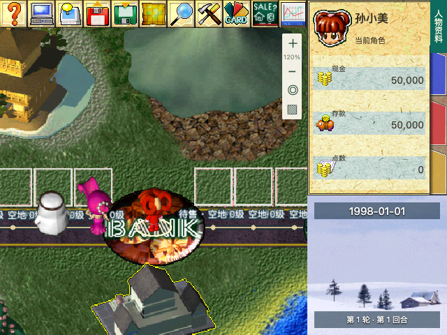

# UI-01：原版主界面骨架

日期：2026-10-18。状态：**已完成本阶段，未部署**。前置：[UI-00 资源审计](original-ui-resource-audit.md)。

## 界面结果

主画面使用一个 640×480 逻辑画布，按 UI-00 的坐标分为工具栏 `(0,0,440,40)`、地图 `(0,40,440,440)`、人物资料 `(440,0,200,280)` 和辅助区 `(440,280,200,200)`。四区统一等比缩放，保留边界与宽高比例；根据可用宽度和操作栏占用的高度调整显示尺寸。

顶部宣传标题、英文口号和常驻长侧栏已移除。原版工具栏接入 11 个入口及正常/悬停图片；439 像素底图保持原尺寸，第 440 列使用边界背景色。右侧接入原版资料板与四季背景，临时显示当前角色、现金、存款、点数和日期。这些字段位置及季节月份映射是现阶段 Web 呈现，不冒充已逐项还原的原版字段规则。

以下为**真实 Web 运行截图**，与 UI-00 的资源组合示意图分别保存：



[桌面完整页面](ui01/desktop.png) · [390×844 页面](ui01/mobile.png)

## 功能与挂起入口

| 入口 / 区域 | UI 状态 | 业务状态 |
| --- | --- | --- |
| 帮助、设置 | 原版工具图标已接入 | 打开现有帮助/声音设置；更多原版设置项后续推进 |
| 托管设置 | 原版工具图标已接入 | 打开现有开局配置；使用已有电脑座位与策略选项 |
| 人物资料 | 工具图标与资料区域已接入 | 当前人物摘要和现有全体角色列表可查看 |
| 道具、卡片 | 原版工具图标已接入 | 暂时共用现有库存面板，保留全部选择/确认逻辑 |
| 地产出售、股票 | 原版工具图标已接入 | 打开当前模式支持的市场；模式未启用时说明原因 |
| 读档、存档 | 保留入口和原版图标 | 暂挂；点击明确提示未接入，不伪装成回放下载 |
| 小地图窗口 | 保留入口和原版图标 | 窗口暂挂；现有地图缩放、全图、跟随角色按钮继续可用 |
| GO、多骰及完整资料字段 | 本阶段保留现有回合操作栏 | 继续使用已有引擎命令，原版呈现交 UI-02 |
| 业务窗口、小游戏 | 收进可展开操作面板，取消常驻长侧栏 | 原组件各挂载一次；业务决策出现时展开并定位，逐窗皮肤交后续阶段 |

符合最新优先级：先复原 UI，未实现业务保留入口并挂起。操作面板仍是过渡呈现，不计为 UI-03～UI-07 的原版窗口皮肤完成。小屏当前保持缩小画布及可用的外部操作栏，手机专用布局、最小触控热区与文字适配仍由 UI-07 完成。

## 实现与资源

- `ClassicGameShell.tsx` / `classic-ui.css`：四区骨架、统一缩放、右侧背景及基本快照展示；改变尺寸和全屏不重建对局。
- `ClassicToolbar.tsx` / `classic-ui-art.json`：使用 UI-00 的帧与锚点，保留原版顺序和全部入口。
- `RichmanPage.tsx`：页面组合、入口提示与已有组件迁移；小游戏保留在可展开面板，避免被 440×440 地图裁切。
- `decision-navigation.ts`：定位业务组件前展开祖先 `details`，确保隐藏面板可以操作；返回地图可收起面板。
- `map-picking.ts` / `scene.ts`：拖动增量按画布显示尺寸换算到逻辑尺寸，与现有点选换算一致，修复外层缩放下拖动距离不一致的问题。
- `prepare-classic-ui.cjs`：从 UI-00 审计清单生成 UI-01 前端映射，核对 PNG 哈希，并登记 **28 张**运行图片到发布白名单；候选业务窗口未全量打包。

资源复跑（原始导出依赖与版本要求同 UI-00）：

```bash
python3 scripts/richman/export_ui.py --game /Users/zsr/Documents/rich4/Game
node scripts/richman/prepare-classic-ui.cjs
node scripts/richman/check-release-assets.cjs
```

## 验证记录

- 前端 lint、TypeScript/Vite 构建通过。构建继续有项目既有的大 chunk 提示，本轮没有改动拆包策略。
- 6 个测试文件、**30 项测试通过**：工具栏入口、嵌套面板展开、缩放后的拖动/点选一致性、地图几何、小游戏组件与对局 session。
- [浏览器结果](ui01/browser-results.json)：真实 Chrome、原始日本地图、正常速度、隔离测试登录。覆盖 1440×1080、640×480、1280×960、844×390、390×844、精确 640×480 画布，以及原生/非原生全屏。
- 验证四区矩形、单个画布、无横向页面溢出、入口及图片加载；读档/存档提示不改变对局 revision，缩放与尺寸切换不重开对局。
- 机器工人地块点选、建筑透明像素点选、空白/右键/拖动不误选、放大/缩小、拖动后点选、暂停、手机、全屏、重开清理均通过。
- [下载回放](ui01/worker-replay.json) 经引擎回放验证：两次建筑升级与遥控骰子消耗正确，资金、库存、随机状态和玩家位置比较通过。退出路由后 `canvas=0`、待执行 RAF=0；浏览器错误列表为空。
- 发布资源输入校验通过：共 73 个资源文件，包含本轮 28 张 UI 图片。本轮只构建前端，尚未生成新的正式 `release/frontend` 发布包、提交、推送或部署。

回归命令：

```bash
npm --prefix frontend run lint
npm --prefix frontend run build
npm --prefix frontend test -- src/features/richman/ClassicToolbar.test.tsx src/features/richman/decision-navigation.test.tsx src/features/richman/map-picking.test.ts src/features/richman/map-geometry.test.ts src/features/richman/MinigamePanel.test.tsx src/features/richman/game/session.test.ts
npm --prefix frontend run dev -- --host 127.0.0.1 --port 5174 --strictPort
# 另一个终端；PLAYWRIGHT_MODULE 可指定已有 Playwright 模块路径
node scripts/richman/classic-shell-browser.cjs
```

下一阶段为 **UI-02：信息与回合操作**，继续原版 GO/骰数、资料字段及小地图/日期切换；尚未实现的业务入口继续保留并明确挂起。
