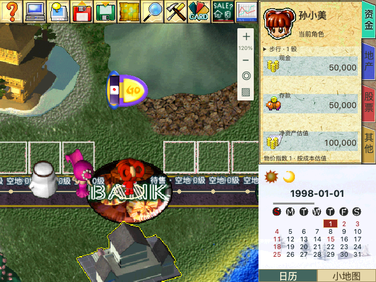

# UI-02：人物资料与回合操作

日期：2026-10-18。状态：**已完成本阶段，未部署**。前置：[UI-01 主界面骨架](ui01-main-shell.md)。

## 本阶段界面

保留 640×480 四区与统一缩放，接入原版 GO、骰数选择、四页人物资料、日历与小地图。GO 初始位于 `(180,120)`，使用 72×67 原图及原始热区。地图选点、移动和业务决策期间隐藏 GO，避免遮挡目标；外部“掷骰出发 / 下一位”按钮保留，方便键盘和手机操作。



[桌面完整页面](ui02/desktop.png) · [小地图](ui02/minimap.png) · [390×844 页面](ui02/mobile.png)

| 区域 | 已接入 UI | 业务范围 |
| --- | --- | --- |
| GO | 普通、停留、乌龟图片及黄底闪动；原掩码热区；鼠标/触控拖动及方向键移动 | 复用掷骰、结束回合命令；暂停、电脑应答及不适用阶段禁止提交；停留图仍允许结束本次停留 |
| 骰数选择 | 步行 1、机车 1–2、汽车 1–3 颗；原版灰/红小骰图 | 复用 traffic 命令；工程车、拘留、梦游等限制沿用已有规则 |
| 实际骰面 | 按本次每颗结果显示原骰面，另列总步数；动画期间显示“掷骰中” | 不把 7–18 的总和塞进单颗骰子；新回合和跳过回合不残留上一位结果 |
| 人物资料 | 资金、地产、股票、其他四页，原 Panel-0 背景 | 读取现金、存款、净资产估值、地产/建筑数、股票市值/成本、控股公司、点数、贷款；缺失业务标“未启用 / 暂未接入” |
| 状态 | 当前角色、暂停/电脑状态、交通与异常状态、工程车、神仙、住宿；点击状态行展开全文 | 保持当前行动者头像，另标跨玩家付款或拍卖/反应的应答人，不切换行动者 |
| 日历 | 原 Panel-2 日历底图、月份天数、当日高亮、休市日 | 使用快照游戏日期与既有日本休市表；没有日历规则的模式明确显示未启用 |
| 小地图 | 日本底图、全部拓扑连线（含单向特殊连接）、产权色点、在场角色、当前视口框 | 点击定位、方向键浏览只调用相机；不派发移动/选择/资产命令，不改变 RNG、余额或回合 |

## 原版证据与 Web 适配

复用 [UI-00 资源审计](original-ui-resource-audit.md) 的只读原始资源、固定版本参考与 SHA-256；没有执行原版 EXE。

- `Panel[7]`：0/1 普通 GO、2/3 停留、4/5 乌龟，6–11 为一到三颗的灰/红骰数选择图。黄色帧按闪动状态使用，不声称是原版悬停帧。Web 闪动周期为 1.2 秒，遵守减少动态效果设置。
- `Panel[8]`：4824 字节原始掩码，SHA-256 `867d59eb45008993ea8dc2fd1af8b32d3316043638643dcc791e50df594b83f5`。本地原版 `0x41796e–0x4179d5` 从掩码值加 10；分支 11 处理骰数、12 在 `0x417ab1` 启动拖动、13 在 `0x417ac9` 调用出发。值 4 留给地图穿透。导出脚本按每行像素生成掩码路径；原图透明角落不会被矩形按钮遮住。
- GO 初值来自全局 `0x47310c/0x473110`。Web 拖动限制在地图区域 `(0..368,40..413)`，保留工具栏和人物栏；原版允许拖到整张画布的行为没有照搬。键盘每次移动 8 个逻辑像素。
- 本地人物资料函数 `0x415866` 使用 `Panel[0]` 的 0–3 帧；`0x415a9d` 读取标签表 `0x4730fc`，四个 Big5 字符串地址为 `0x4618c1/0x4618c6/0x4618cb/0x4618d0`，原文“資金 / 地產 / 股票 / 其他”。Web 使用对应简体标签。原版每项精确字体与逐字位置尚未宣称像素一致。
- 前三页的字段类别参考固定版本的资料绘制分支。Web 净资产明确标为成本估值：现金＋存款＋地产地价/建造成本＋当前持股市值－贷款，不作为胜负判定或出售报价。特殊建筑按单次建造成本计；未实现的第四页剩余原版资料留占位，不伪造数值。
- `Panel[2]` 的 4–7 帧用于日历；季节按月份映射、HTML 日期和天数网格属于 Web 呈现。日历/小地图底部切换、小地图道路线/产权点/视口框也是 Web 适配，不声称已复刻原版小地图全部绘制细节。相机框沿用场景统计节奏，连续地图拖动/角色跟随最多约 1 秒更新；小地图点按/键盘操作立即更新。

## 代码与资源

- `ClassicGo.tsx`：原图、掩码命中、拖动、回合及骰数入口。
- `ClassicDice.tsx` / `classic-presentation.ts`：实际骰面、按钮可用性和只读资料汇总。
- `ClassicPlayerPanel.tsx` / `ClassicAuxiliary.tsx`：人物页、状态、日历与小地图。
- `ClassicGameShell.tsx` / `RichmanPage.tsx`：组合界面与现有命令，不改游戏规则。
- `scene.ts`：新增相机信息与 `panTo`，仅更新展示视角。
- `prepare-classic-ui.cjs`：先校验审计 PNG 和 GO 掩码哈希，再生成路径/前端清单与发布白名单。UI 图片从 28 张增至 **47 张**；发布资源输入共 **92 个文件**。

UI-00 审计中的 `runtimeIntegrated: false` 描述当时审计阶段，不是当前功能状态。运行接入情况以本阶段文档、前端映射及发布白名单为准。正式 `release/frontend/` 尚未重新打包；发布时仍须遵守仓库 Git 同步后部署的流程。

## 验证

- lint、TypeScript/Vite 构建通过；既有大 chunk 与数学/PDF 模块混合导入提示保留。
- 7 个测试文件、**43 项通过**：新增重排角色座位与资产映射、其他玩家应答、三骰与总和、新回合清除、暂停/电脑/决策禁用、停留/乌龟/梦游、GO 键盘边界、闰年日历、小地图只读定位及单向特殊道路；并复跑 UI-01 地图、导航、小游戏、session 测试。
- [完整浏览器结果](ui02/browser-results.json)：桌面、390px 手机、横屏、精确 640×480、原生/回退全屏；原图加载、四区几何、GO 掩码和透明穿透、按缩放拖动、小地图鼠标/键盘定位且 revision 不变、实际 GO 出发和骰面显示。
- [构建产物浏览器结果](ui02/built-browser-results.json)：独立 Vite preview 检查真正打包 JS、图片、人物/日历页、GO、小地图和离开页面清理，浏览器错误为空。
- [机器工人回放](ui02/worker-replay.json)：沿用真实日本地图和正常速度，两次建造、遥控骰子消耗、资金、库存、随机状态及位置比较通过。地图业务没有注入测试状态。离开路由后 canvas 与 RAF 均归零。

复跑命令：

```bash
node scripts/richman/prepare-classic-ui.cjs
node scripts/richman/check-release-assets.cjs
npm --prefix frontend run lint
npm --prefix frontend run build
npm --prefix frontend test -- src/features/richman/ClassicTurnUI.test.tsx src/features/richman/ClassicToolbar.test.tsx src/features/richman/decision-navigation.test.tsx src/features/richman/map-picking.test.ts src/features/richman/map-geometry.test.ts src/features/richman/MinigamePanel.test.tsx src/features/richman/game/session.test.ts
# 本地 dev 服务 5174；Playwright 路径按运行环境设置。
PLAYWRIGHT_MODULE=/path/to/playwright node scripts/richman/classic-turn-browser.cjs
# 构建产物另启本地 preview 5175，再执行：
RICHMAN_TEST_BASE_URL=http://127.0.0.1:5175 RICHMAN_BUILT_SMOKE=1 RICHMAN_TEST_OUTPUT=/private/tmp/richman-ui02-built PLAYWRIGHT_MODULE=/path/to/playwright node scripts/richman/classic-turn-browser.cjs
```

## 后续边界

读档、存档以及未实现资料业务继续保留入口并挂起。人物全览等业务窗口仍通过现有操作面板访问；窗口宿主、模态焦点与防重入进入 **UI-03**。逐窗原版皮肤、手机触控放大和整体精修按原计划后续阶段完成。本阶段未提交、推送或部署。
