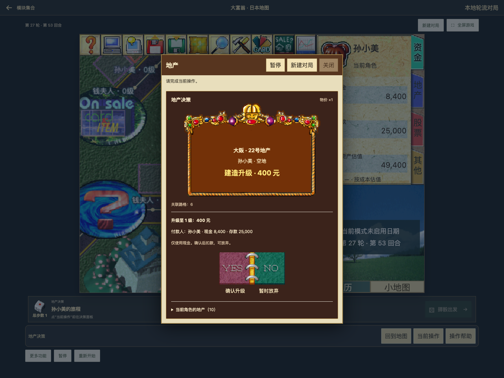
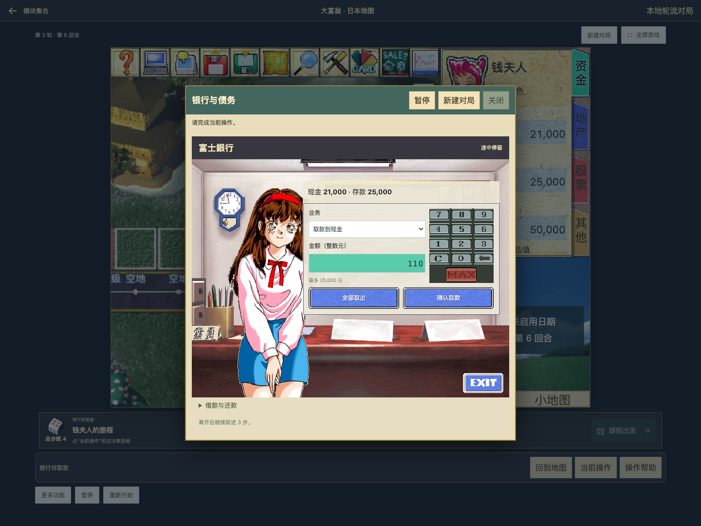

# UI-04：地产、目标选择与基础银行窗口

日期：2026-10-18。状态：**本阶段已实现并验证，未部署**。前置：[UI-03 统一窗口](ui03-window-host.md)。

## 已还原的界面

地产窗口接入本地原版宝石提示框与 YES/NO 按钮；保留明确中文操作名、实际付款人、报价、租金明细与现金/存款扣款顺序。购买和升级可放弃，租金没有跳过按钮。大型用地的建筑类型选择继续使用现有业务。



银行使用原版柜台背景、蓝色按钮和数字按键，原图 EXIT 位置接入已有离行命令。支持键盘输入、数字点按、清空、退格与 MAX；编辑金额不提交命令，只有确认按钮转账。手机保留整张场景图，将表单移到下方，并将按键触控区域放大到至少 44px 高；按键图保持比例。



[购买](ui04/property-buy.png) · [租金](ui04/property-rent.png) · [手机银行](ui04/bank-mobile.png) · [手机地图选点](ui04/map-selection-mobile.png) · [全屏地图选点](ui04/map-selection-fullscreen.png)

| 范围 | UI 状态 | 业务与关闭语义 |
| --- | --- | --- |
| 地产购买/升级/租金 | 原版提示框和确认图已接入；信息区使用深棕配色 | 沿用报价、真实 payerId、资金校验与原命令；暂停禁用；租金不能用 NO 或通用关闭跳过 |
| 邻近/当前地块机器工人 | 原版提示框与 YES/NO，目标预览与列表 | 地图点选/定位仅预览；确认才消耗，取消不消耗；已选目标跨手机/全屏保留 |
| 遥控骰子、路障、机器娃娃、均贫卡 | 共用原版提示与确认素材 | 复用点数/目标选择、预览和现有合法性；选点窗口仍可收起查看地图 |
| 基础银行存取款 | 原柜台背景、数字键、蓝按钮和 EXIT 热区 | 沿用余额、整数金额、银行拒绝往来、途中/落点与剩余步数；只提交已有存取款/离行命令 |
| 借款与还款 | 已支持模式保留原表单；未启用模式保留可展开入口和说明 | 本阶段不扩充贷款规则，也不把已有贷款功能隐藏 |
| G1–G7 高级道具/卡片、经营、债务/结局 | 保留 UI-03 的功能窗口 | 详细内部布局、专用资源和完整演出继续按 UI-05/06/07 推进 |

## 素材确认与版本差异

没有运行原版 EXE。只读本地资源及静态调用，参考固定提交 [mytbk/rich4 ec7d70e](https://github.com/mytbk/rich4/tree/ec7d70e693059d1e781d9d1cc2ad7f36d360d39e)。新增 [本地补充审计](ui04/additional-assets.json) 记录原文件哈希、帧尺寸、锚点、PNG/RGBA 哈希与本地程序字节证据；[导出器](../../scripts/richman/export_ui04.py) 可复跑，重复导出结果一致。

参考版本中的 Data[517]、Data[440] **不能直接套用到本地**：本地这两条记录不是对应图像。已通过本地调用重新确认 Data[476]、Data[399]，未沿用错误索引，也未修改 UI-00 的历史清单。

| 素材 | 本地证据 | 本次使用 |
| --- | --- | --- |
| Data[476] 帧 5 | `0x407cad–0x407cca` 加载；`0x43f86d–0x43f8f0` 使用帧偏移 `0x48`，参考点 `(220,130)`，随后调用确认窗口 | 195×133 宝石提示框，保留比例放大；[联系表](ui04/Data-476-sheet-01.png) |
| Data[399] 帧 0/1/2 | `0x452136–0x452153` 加载；本地确认调用 `0x45211c`，参考实现对应左右半区选择 | 96×48 原图拆为两个可访问按钮，使用正常/左右亮起图；[联系表](ui04/Data-399-sheet-01.png) |
| Panel[23] 帧 0、16、17 | 本地 `0x435ba1–0x435bb5` 加载银行组；原图和哈希沿用 UI-00 | 640×480 柜台场景与蓝色按钮；按钮边框按九宫格延展，Web hover 绑定备用图，不声称已核实该帧的全部原生状态 |
| Panel[21] 帧 2、4–15 | UI-00 已审计数字键，图像直接标出 MAX、C、退格与 0–9 | 可编辑金额键盘；布局、触屏热区、输入校验沿用 Web 需要，非原生热区逐像素复刻 |

本次新增发布图片 **20 张**，累计 **67 张 UI 图片 / 112 个发布资源文件**。原 UI-00 450 帧审计不改写为当前接入数量。ATM Panel[24] 与柜台是不同原版界面，本阶段没有把它们混接为同一画面。

原版使用更紧凑的提示及确认布局；Web 为可读性放大素材，并保留付款人、收费明细、键盘焦点和不可跳过的租金确认。目标列表、二次确认、银行表单位置及手机重排属于 Web 适配，**不声称与原版逐像素一致**。原版银行人物口型、完整借贷场景及选择目标的像素遮挡演出仍未移植。

## 实现与验证

- `ClassicDecisionArt.tsx` 提供原图提示、确认和数字键；各组件继续使用原业务回调。`window-input.ts` 允许数字键快速重复输入，确认按钮继续过滤双击第二次提交。
- `PropertyPanel`、`FinancePanel`、基础 `ItemPanel` 选择页及 `NearbyWorkerChoice`、`RoadToolChoice`、`CardChoice` 接入上述展示；未修改引擎、地图、经济或 AI 规则。
- 13 个测试文件 **90 项通过**，覆盖实际付款人、升级/租金不可跳过、金额合法性、暂停/银行拒绝往来、数字键编辑与 MAX、旧业务回调、窗口焦点/防重入、地图、GO、小游戏及 session。
- lint、TypeScript/Vite build、112 文件资源校验与 `git diff --check` 通过。构建仍有既有大 chunk、数学/PDF 模块混合导入提示。
- [真实业务浏览器结果](ui04/business-results.json)：种子 `ui04-1`，2 人原版日本地图，138 次界面操作推进到第 53 回合，覆盖购买、升级、租金和银行。为节省等待只重复调用已有 50ms 动画 tick，不注入位置、余额或决策。所有选择与交易通过可见 UI 完成。
- [业务回放](ui04/business-replay.json)：重放后全部资产状态、回合及阶段与独立引擎规划结果一致；银行快速输入 `110` 不派发命令，双击确认各只转账一次，取款与存款均验证。
- [选点/窗口回归](ui04/window-results.json)：原速机器工人地图选择、遥控骰子、暂停、全屏/手机、收起恢复、必答窗口与重复提交；[选点回放](ui04/window-replay.json) 消耗和建造次数正确，离开路由后 canvas/RAF 为零。
- [打包产物结果](ui04/built-results.json)：独立 preview 实际操作购买、银行数字键、存取款和 EXIT，并检查手机布局；不依赖开发环境模块。各浏览器记录错误为空。

复跑：

```bash
# Python 需要 Pillow、NumPy；只读原游戏目录。
python3 scripts/richman/export_ui04.py --game /Users/zsr/Documents/rich4/Game
node scripts/richman/prepare-classic-ui.cjs
node scripts/richman/check-release-assets.cjs
npm --prefix frontend run lint
npm --prefix frontend run build
# 测试文件名与本节清单对应，运行 frontend 的 vitest。
PLAYWRIGHT_MODULE=/path/to/playwright node scripts/richman/classic-property-bank-browser.cjs
RICHMAN_TEST_OUTPUT=/private/tmp/richman-ui04-window PLAYWRIGHT_MODULE=/path/to/playwright node scripts/richman/classic-window-browser.cjs
# build 后启动 preview 5175；读取上一条业务脚本生成的 plan.json：
RICHMAN_TEST_BASE_URL=http://127.0.0.1:5175 RICHMAN_BUILT_SMOKE=1 RICHMAN_TEST_OUTPUT=/private/tmp/richman-ui04-built PLAYWRIGHT_MODULE=/path/to/playwright node scripts/richman/classic-property-bank-browser.cjs
```

下一阶段 **UI-05：库存与经营窗口**。本阶段未提交、推送、制作正式发布包或部署；未接入业务继续保留入口并挂起。
