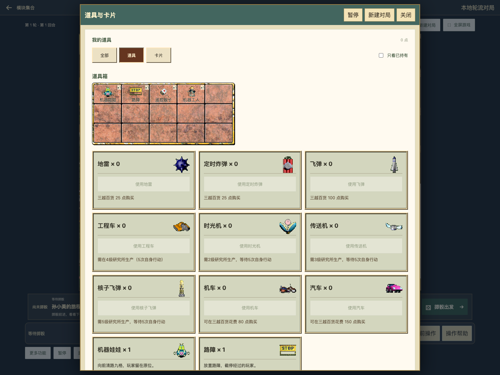
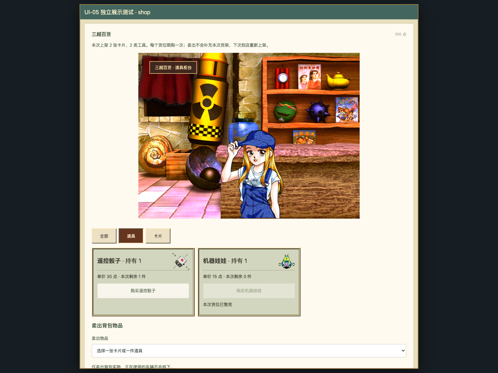

# UI-05 · 库存与经营窗口

2026-10-19。本地实现；未提交、未打包正式 release、未部署。沿用全部现有规则与命令。UI 接入完成，原版演出及未核实细节另列暂缓，不计为像素级完全复原。

## 入口、界面与业务

| 旧组件 / 入口 | UI-05 界面 | 业务状态与验收 |
| --- | --- | --- |
| ItemPanel / 顶栏道具、卡片 | 两个入口分别选中道具/卡片；原版 5×3 库存格、13 种工具原图、卡包槽序与数量；分类目录和“只看已持有” | 使用/购买、合法目标与禁用理由保留；查看格位只定位说明，不能消耗物品；筛选后的失败提示仍可见 |
| ShopAcquisitionPanel / 三越落点 | 原道具店与卡片店背景、店员；类别切换、商品图、点数/持有/单价/剩余货位 | 抽样货架、赠品、重复货位合并计数、售罄、卡包上限、卖出与离店沿用旧逻辑；旧模式商店同样接入分类外观 |
| G6Panel / 顶栏股票 | 行情表默认展开、选行切换股票、原版图表底图、现有历史价格折线、买卖表单 | 银行余额、余股、限额、成本、盈亏、休市、停牌、涨跌停保留；切股票清空股数，选行不交易；费用说明收进展开项 |
| EstateSalesPanel / 顶栏地产出售 | 公布栏抬头、挂牌/关闭按钮、出售类别、挂牌和购买表单 | 地产挂牌/改价/撤回/购买不变；股票、卡片、道具挂牌显式保留“暂未接入”禁用入口 |
| ResearchPanel / 更多功能→研究生产 | 项目格、对应原版工具图、生产表单 | 点项目只选择，确认才提交；暂停锁定；任务与取消条件不变 |
| CommercePanel / 日产建造与现场认股 | 账本式窗口、目标/建筑类型/定位、认股数量与现金预览 | 既有建造、取消服务费、现金认股及跳过命令保留；没有增加未实现的公司服务 |
| CompanyPanel / 公司营业结算 | 账单窗口，来访者、经营者、实际付款人、现金/银行及公司账本 | 实际账单与确认 token 保留；经营者不是收款账户；不改变反应/债务顺序 |
| FacilityPanel / 医院、监狱探访 | 对应原场景，场景格位可选择当前名单玩家，显示剩余次数；下方保留选择器 | 格位与选择器同步；确认付 30 点才提交；暂停、无对象、点数不足沿用旧限制 |
| InsurancePanel / 保险办理与赔付 | 原保险转盘和天使图、期限卡、办理/保单/赔付账本 | 转盘按钮仍调用现有抽取一次的命令；没有伪造停盘动画或修改随机数 |
| LotteryPanel / 彩票站 | 原场景、店员、可点选 1–36 号码板、已售与当前选中状态 | 点号码只改草稿，确认才买；现金不足/售罄/暂停禁用；查看历史时号码只读；原选择器与奖池/开奖信息保留 |

所有界面继续由 UI-03 单实例窗口宿主承载。原版卡片库存的参考实现绘制卡名文字，故保留文字卡格，不把卡片没有插画认定为 30 张缺图。工具图只装饰，按钮仍有完整可访问名称。手机库存改为单列，彩票改为 6×6、触控高度至少 44px；表格可在窗口内横向滚动。

## 素材证据

本地原版文件只读，四个固定源哈希与 UI-00 一致。新增 [补充审计](ui05/additional-assets.json) 导出 8 组 127 帧用于检查，记录 PNG/RGBA 哈希、尺寸、锚点、源文件哈希及本地 EXE 字节段。UI-00 历史审计保持不变。固定参考：[mytbk/rich4 ec7d70e](https://github.com/mytbk/rich4/tree/ec7d70e693059d1e781d9d1cc2ad7f36d360d39e)。未运行 Windows 原版。

| 资源 | 使用帧 | 身份依据 |
| --- | --- | --- |
| Panel[11] | 0–14：两个库存格与 13 种道具 | 本地工具入口 `0x44696a–0x446987`、卡片入口 `0x440819–0x440837`；参考 use_tool 以零基道具编号+2绘图，use_card 以卡名绘制格位 |
| Panel[10] | 0/2 卡店背景/店员，16/18 道具店背景/店员 | 本地商店加载 `0x42de2d–0x42de50`；图像沿用 UI-00 的哈希审计 |
| Panel[12] | 0/1 彩票背景/店员 | 本地彩票加载 `0x4309d7–0x4309f5`，参考 ui_letou |
| Panel[63]/[65] | 各帧 0，监狱/医院场景 | 本地 `0x43c084–0x43c093` / `0x43d705–0x43d714`，参考 ui_prison / ui_hospital |
| Panel[71] | 0/2 天使/转盘静态图 | 本地 `0x43f585–0x43f5ac` 加载 `Panel[68+(参数&3)]`；保险入口 `0x41a259–0x41a261` 传 3。参考保险调用链与已有 s2-03p 记录一致 |
| Panel[73] | 0 公布栏 | 本地出售加载 `0x427aa8–0x427ab7`，参考 ui_sale |
| Panel[75]/[76] | 各帧 0，股票表头纹理/走势图底图 | 本地 `0x42ab10–0x42ab1f` / `0x42b03a–0x42b049`；参考 ui_stock。图表折线由现有 Web 历史价格绘制 |

本阶段运行包增加 **28 张**已核实 PNG，累计 **95 张 UI 图 / 140 个资源文件**。只将实际使用帧登记到 release-assets.json，检查通过后才允许进入后续正式发布。联系表仍是检查材料，不作为游戏运行资源。

复跑导出与清单检查：

```bash
python3 scripts/richman/export_ui05.py --game /Users/zsr/Documents/rich4/Game
node scripts/richman/prepare-classic-ui.cjs
node scripts/richman/check-release-assets.cjs
```

导出使用带 Pillow 的 Python。导出前后都校验四个原版文件；不修改原文件。

## 验证与截图

组件回归共 91 项通过（15 个文件先通过 90 项，新增研究选择后专项 5 项复核；去重合计 91）。覆盖库存、商店、股票、彩票、地产出售、保险、公司、认股、探访、研究选择，以及 UI-01～04 的工具栏、回合、宿主、银行和地产。lint、TypeScript/Vite 构建通过；原有大 chunk、PDF 模块导入警告保留。

浏览器脚本：[classic-business-browser.cjs](../../scripts/richman/classic-business-browser.cjs)。

- 实际页面：建立 surrender 对局；顶栏道具/卡片分类不改变 revision；股票买 2 股、卖 1 股；检查出售未接入类别；导出真实回放并验证两条交易命令；桌面/390px 浏览。
- 独立展示夹具：商店买入、售罄、分类；彩票 36 号选择/确认；保险办理；现金认股；公司账单确认；研究选择/开工；医院和监狱场景选择/付点数。验证回调参数和手机布局，控制台无错误。夹具不是实际地图长局验收，也没有修改实际对局状态；截图抬头明确标识“独立展示测试”。
- 构建产物检查：同一脚本设置 `RICHMAN_BUILT_SMOKE=1`，仅运行真实页面部分，不依赖源码导入夹具。

[浏览器结果](ui05/results.json) · [构建产物结果](ui05/built-results.json) · [交易回放](ui05/replay.json)



[卡片窗口](ui05/inventory-cards-desktop.png) · [手机库存](ui05/inventory-mobile.png) · [股票交易](ui05/stock-desktop.png) · [出售窗口](ui05/sale-desktop.png)



[卡片柜台](ui05/shop-cards-desktop.png) · [彩票号码板](ui05/lottery-desktop.png) · [手机彩票](ui05/lottery-mobile.png) · [保险转盘](ui05/insurance-desktop.png) · [手机监狱探访](ui05/prison-mobile.png) · [医院探访](ui05/hospital-desktop.png)

## 暂缓与下一阶段

| 项目 | UI 状态 | 业务状态 / 恢复条件 |
| --- | --- | --- |
| 原保险按键减速、店员眨眼/说话、语音 | 静态原图已接入；完整演出暂缓 | 保留现有命令时序，后续独立核实动画状态与停止点，不改变抽取算法 |
| 医院/监狱角色的躺卧、栏杆等逐角色帧 | 场景与可点选名单已完成；使用文字玩家格，未冒用未核实角色对应帧 | 按角色帧身份核实后替换装饰；探访业务已可用 |
| 公司/认股/研究的专用原版布局细节 | 使用统一经营账本外框和现有字段，未宣称原生坐标完全一致 | 后续确认原调用中的提示/表单构图，保留当前入口和功能 |
| 原版股票随机算法、原生走势图热区 | 原图底图+现有历史数据绘图；Web 选行/表单布局 | 算法不是本轮 UI 范围，不改现有交易与回放 |
| 股票/卡片/道具挂牌 | 出售类别入口保留并标明未接入 | 挂起业务，另立规则核验与交易接入任务 |
| 其他地图、特殊角色、存读档 | 保留既有明确提示 | 不在 UI-05 扩展业务 |

继续 UI-06：新闻、命运、魔法屋、拍卖、反应、债务/处置、认输及小游戏外框。UI-08 总验收仍需逐项对照以上差异，不能把本阶段视为整套原版 UI 100% 完成。
