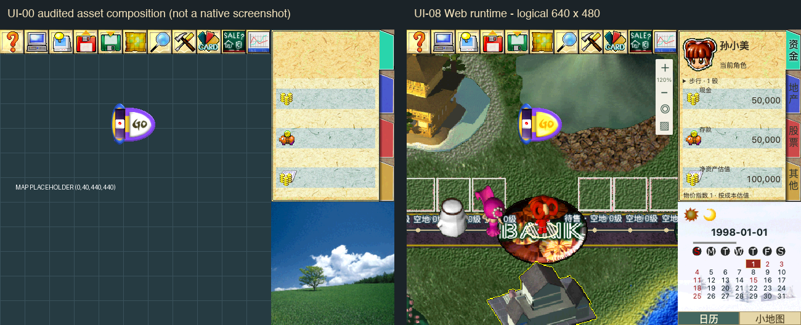

# UI-08 验证附件

[验收报告](../ui08-acceptance-release.md) · [暂缓和视觉差异](../ui08-deferred.md) · [发布包摘要](release-summary.json) · [打包日志](package.log) · [发布校验](verify.log) · [Lint](lint.log) · [发布校验器测试](release-tests.log) · [8 项素材导出测试](export-tests.log)

[测试汇总](test-summary.json) · [运行文件一致性](runtime-equivalence.json) · [全量测试前段](tests-part1.log) · [后段及旧断言失败](tests-part2.log) · [修复后复测](date-retest.log) · [分段清单](test-partition.json) · [归档哈希核对](prefix-archive-check.json)

最终去重 188 个测试文件、2685 项通过；复测不重复计数。研究/综合策略重复前缀优化边界见验收报告。

## 总览与截图

左侧是 UI-00 已审计素材组合，地图为占位网格，**不是原版运行截图**；右侧是本轮 Web 实际 640×480 逻辑画布。精确文字位置、日历、小地图和手机布局属于已记录的 Web 适配。

| 界面 | 本轮截图 |
| --- | --- |
| 菜单 | [桌面](built/system/title-desktop.png)、[竖屏](built/system/title-portrait.png) |
| 系统设置 | [竖屏](built/system/options-portrait.png) |
| 游戏横屏 | [查看](built/system/game-landscape.png) |
| 高 DPI | [桌面](built/acceptance/desktop-dpr2.png)、[竖屏](built/acceptance/portrait-dpr2.png) |
| 地图选择 | [手机浮动窗口](window/map-selection-mobile.png) |
| 目录 | [29 项入口](window/directory.png) |
| 银行 | [桌面](property-bank/bank-desktop.png)、[手机](property-bank/bank-mobile.png) |
| 地产 | [升级](property-bank/property-upgrade.png)、[租金](property-bank/property-rent.png) |
| 库存 / 股票 | [道具](built/business/inventory-tools-desktop.png)、[手机股票](built/business/stock-mobile.png) |
| 事件夹具 | [新闻](event/news-desktop.png)、[命运](event/fortune-mobile.png)、[魔法屋](event/magic-desktop.png)、[拍卖](event/auction-desktop.png)、[小游戏](event/minigame-mobile.png) |
| 对局结果 | [手机](built/system/result-portrait.png) |
| 失败重试 | [必需资源故障](built/acceptance/required-error.png) |

截图保留当前视口或完整页面。长窗口内部可滚动；小游戏、稀有事件和经营专用画面使用明确标识的独立展示夹具，不能作为地图自然触发证据。

[同机性能数据](performance/results.json) · [改造前截图](performance/baseline.png) · [当前发布包截图](performance/candidate.png) · [手机真实触摸事件](built/touch/results.json)

## 运行结果

| 验证 | 结果 |
| --- | --- |
| UI-01 布局和入口 | [结果](shell/results.json) |
| UI-02 回合控件 | [结果](turn/results.json) |
| UI-03 原速地图/窗口 | [结果](window/results.json)、[回放](window/replay.json) |
| UI-03 DPR 2 | [结果](window-dpr2/results.json)、[回放](window-dpr2/replay.json) |
| UI-04 地产与银行 | [138 操作结果](property-bank/results.json)、[回放](property-bank/replay.json)、[生产包 21 操作结果](built/property-bank/results.json) |
| UI-05 库存与经营 | [开发及夹具](business/results.json)、[生产包](built/business/results.json) |
| UI-06 事件与应答 | [开发及夹具](event/results.json)、[生产包](built/event/results.json) |
| UI-07 菜单及六种尺寸 | [生产包结果](built/system/results.json)、[结果回放](built/system/replay.json) |
| UI-08 入口/资源/异常/清理 | [开发](acceptance/results.json)、[生产包](built/acceptance/results.json)、[实际电脑回放](built/acceptance/computer-replay.json) |

浏览器仅使用本地测试鉴权，不连接生产数据库。故障测试刻意让指定资源返回 404 或损坏数据，这类预期故障与正常发布资源完整性分开记录。
